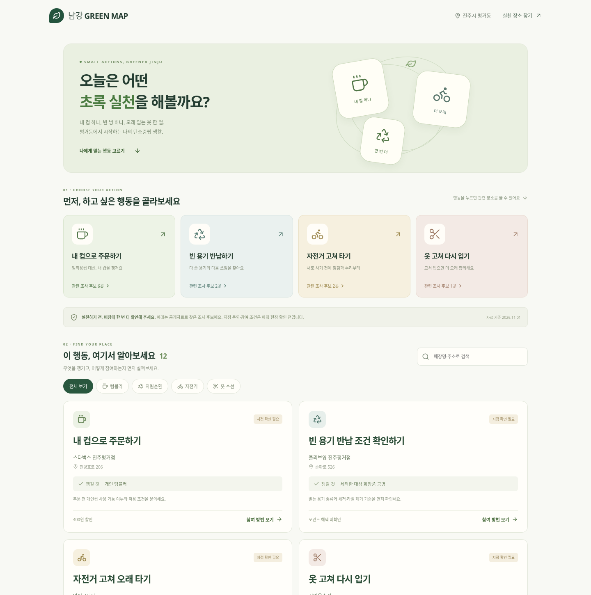
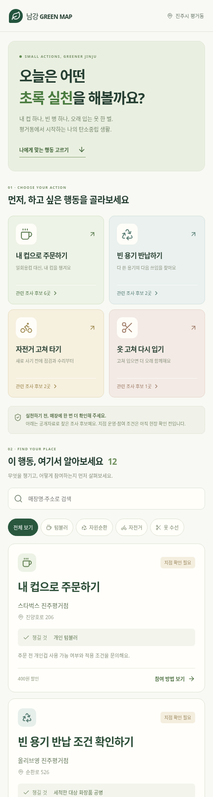
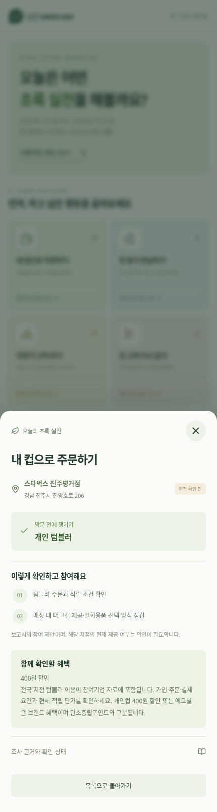

# 행동 중심 UI 시각화

`?preview=actions`에서 행동 선택 중심의 새 UI를 확인할 수 있다. 기존 화면은 유지하며 별도 경로로 비교한다.

- 첫 화면: 오늘 어떤 실천을 할지 선택.
- 행동 카드: 개인컵, 빈 용기, 자전거 수리, 옷 수선. 번호·배치·아이콘으로 행동 분류를 제시한다.
- 장소 카드: 행동 제목 → 실제 보고서 매장명·주소 → 챙길 것 → 방문 전 확인 방법 → 보조 혜택.
- 현장 확인 전 상태와 조사 후보임을 눈에 띄게 표시한다.
- 자원순환·자전거·수선에 확인되지 않은 할인이나 포인트를 만들지 않는다.
- 자연드림은 전체 목록에서 기존 보고서의 포장 저감 활동 확인 후보로 유지한다.
- 새 매장, 좌표, 감축량, 인증을 생성하지 않는다. 외부 API·폰트·이미지 요청이 없다.

실제 브라우저 캡처:

프로덕션 빌드와 모바일·태블릿·데스크톱에서 행동 필터, 검색, 빈 결과, 상세, 외부 요청 없음 검증을 수행했다. 공개 사이트의 해당 버전 배포 성공 여부는 별도 확인이 필요하다.
