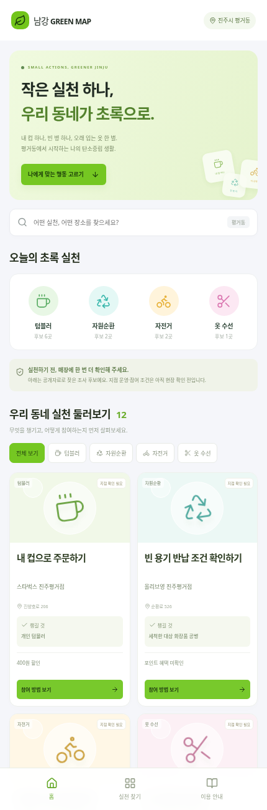
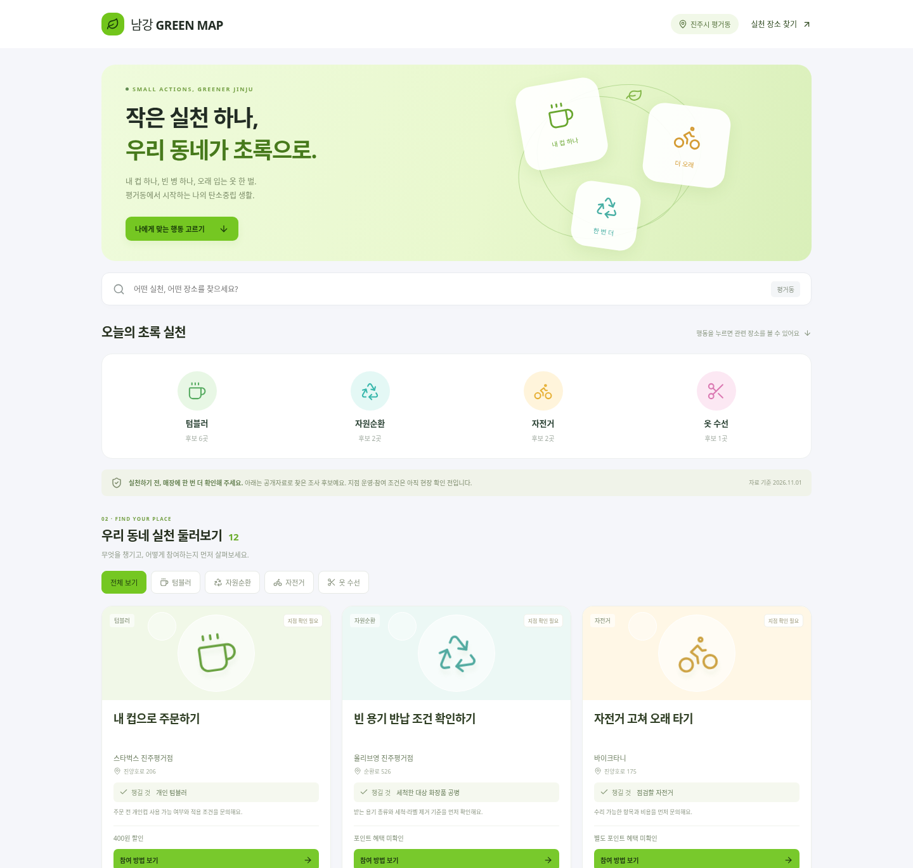
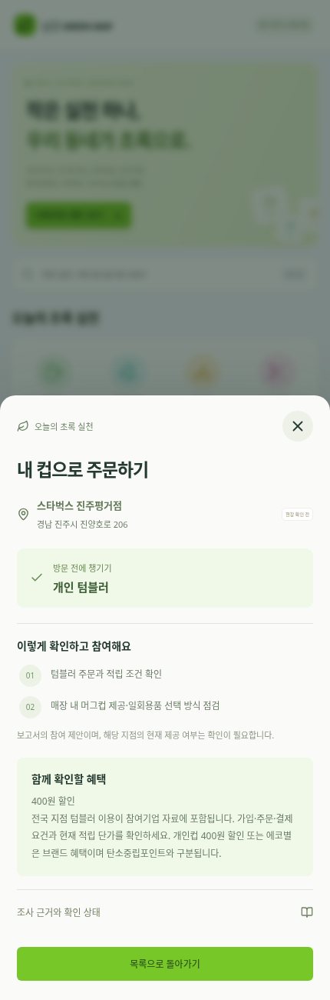

# 라임색 카드형 UI

사용자가 제공한 BIG CART 참고 이미지의 시각적 특징을 남강 GREEN MAP에 맞춰 적용했다. `?preview=fresh`로 열 수 있는 비교용 디자인이다.

- 밝은 라임색 배너와 버튼, 흰색 카드, 연한 회색 배경.
- 행동 유형을 파스텔 원형 아이콘으로 구분.
- 모바일 2열, 넓은 화면 3열 실천 카드.
- 카드 이미지 영역에는 행동을 설명하는 아이콘을 사용한다. 실제 매장이나 제품 사진이 아니다.
- 검색, 행동 필터, 참여 방법 상세와 조사 근거를 유지한다.
- 모바일 하단 홈·실천 찾기·이용 안내가 동작한다.
- 외부 API·이미지·폰트 요청을 하지 않으며 장바구니·결제·별점·인증·감축량을 추가하지 않는다.

기존 행동 중심 UI는 `?preview=actions`, 첨부 변경안 기반 UI는 `?preview=visual`로 비교할 수 있다. 자료에 없는 매장·활동·혜택을 생성하지 않았다.

실제 브라우저 캡처:

프로덕션 빌드 통과. 새 디자인과 기존 행동 화면에 대해 모바일·태블릿·데스크톱에서 필터·상세·검색·빈 상태·메뉴·외부 요청 없음 테스트 6건 통과. 공개 사이트 배포 완료는 별도 확인이 필요하다.
