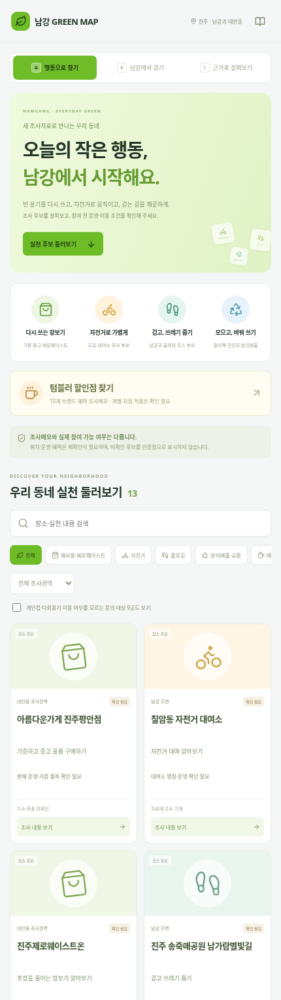
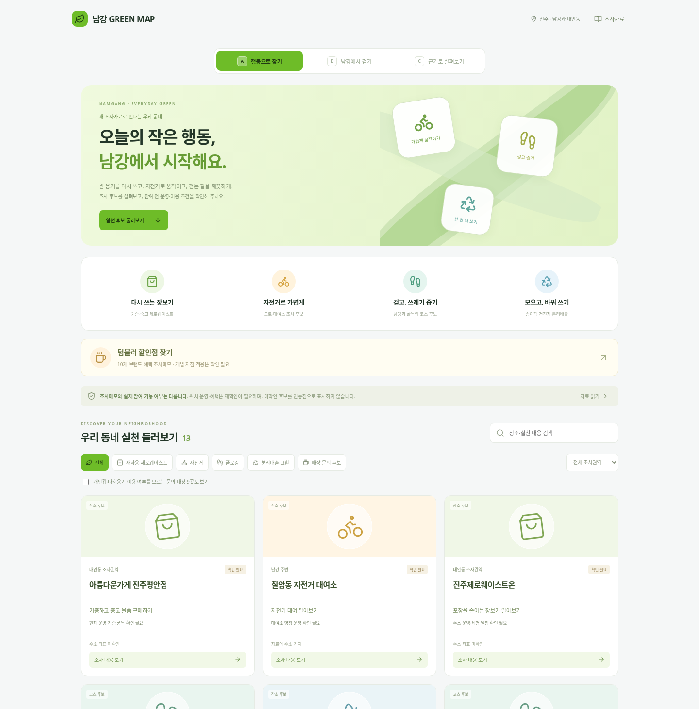
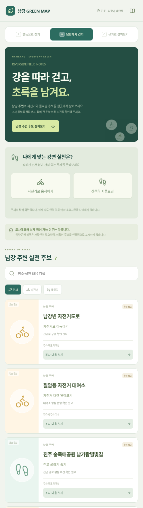
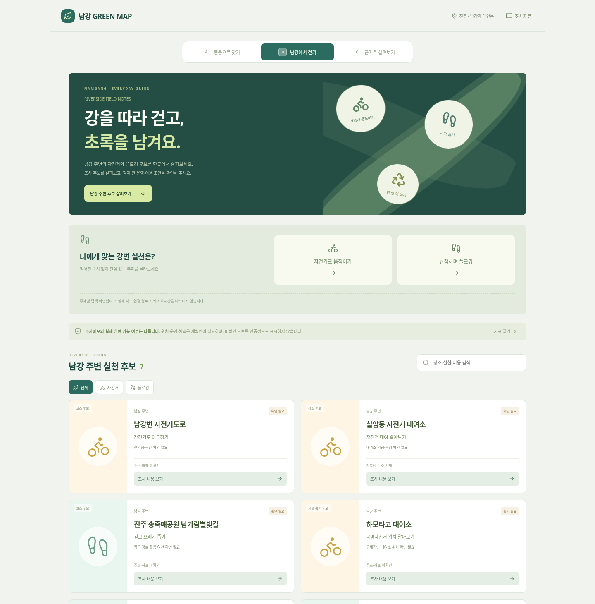
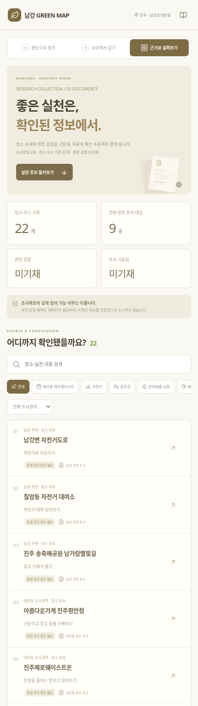
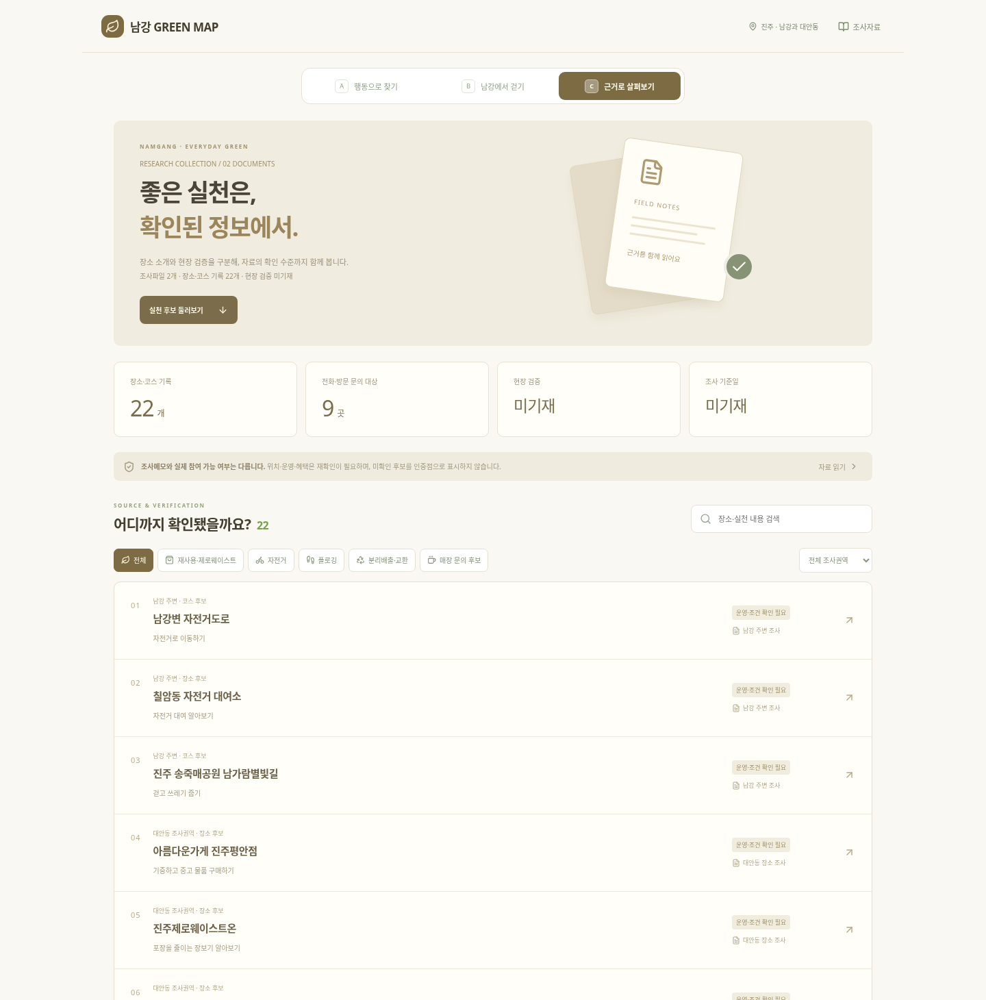

# 새 조사자료 반영 · 세 가지 UI

자료: 사용자 제공 `남강 주변.hwpx`, `진주시 대안동 탄소중립과 자원순환 장소.docx`.

## 반영 원칙

두 문서에서 장소·코스·시설 확인 후보·매장 문의 대상 22개를 정리했다. 문의 대상 9곳은 개인컵·다회용기 이용 가능 매장으로 확정하지 않는다. 브랜드 혜택 메모 10개는 지점명 없는 별도 자료로 보관한다. 기존 평거동 보고서 12곳과 새로운 자료를 합쳐서 검증 완료로 표시하지 않는다.

- 주소가 명시된 항목은 칠암동 자전거 대여소 1개. 명칭·운영은 별도 확인 필요.
- 나머지 주소·좌표는 미기재 상태 유지.
- 조사 기준일·현장 검증일은 자료에 없어 null 유지.
- 대안동 조사권역은 문서의 범위이며 각 장소의 실제 행정동을 확인한 것은 아님.
- 공식 프로그램, 장비 제공, 코스 연결, 거리·시간·감축량, 인증, 교환 비율을 생성하지 않음.
- 탄소중립포인트 1회 300원·다음 달 환급은 메모에 적힌 내용으로만 안내. 현행 요건·단가·지급 주기 미검증.
- 칠암동에 거점이 없다는 문구는 조사 메모이며 지역 전체의 시설 부재로 단정하지 않음.

## A. 행동별 카드 탐색형

`?preview=research&layout=discover`

밝은 라임색, 행동 아이콘, 장소 카드. 재사용·자전거·플로깅·분리배출 필터와 권역 검색. 확인 전 문의 대상 9곳은 체크박스로 따로 포함한다. 텀블러 브랜드 메모는 별도 창에 표시한다.

## B. 남강 산책·자전거형

`?preview=research&layout=river`

딥그린과 강의 흐름을 표현한 장식, 남강 주변 후보 7개, 가로형 코스 카드. 주제별 탐색이며 실제 지도나 확정된 연속 이동 경로가 아니다.

## C. 조사 근거·장소 목록형

`?preview=research&layout=evidence`

크림색 자료실형 UI. 기록 22개, 문의 대상 9곳, 검증·조사일 미기재를 요약하고 자료 출처와 확인 수준을 함께 표시한다.

## 코드와 검증

src/research/places.json과 policies.json을 분리하고 ResearchShowcase.tsx에서 공통 필터·출처·상세를 관리한다. 외부 지도·이미지·폰트 API 요청 없이 동작한다. 프로덕션 빌드, 자료 제약 테스트 및 모바일·태블릿·데스크톱 브라우저 테스트를 수행한다. 실제 장소 운영이나 혜택은 검증하지 않았다. 공개 배포 성공 여부는 별도 확인 필요.
